

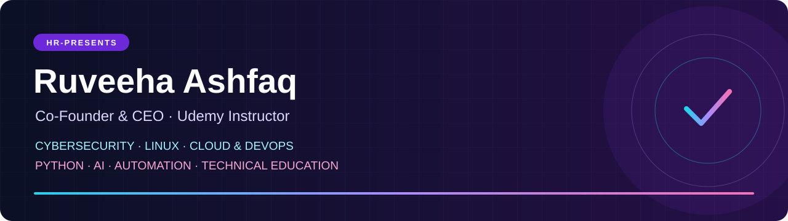

# Ruveeha Ashfaq

Mandi Bahauddin, Pakistan · AIOPS Level 6 student

[Projects](#featured-engineering-work) · [Demo gallery](demo-gallery.md) · [Tech stack](#-tech-stack) · [Courses](#our-udemy-courses) · [Credentials](#credentials--training) · [Background](professional-background.md)

---

Python, Linux and defensive security projects, built through study, hands-on labs and collaboration.

## Featured engineering work

<table>
<tr>
<td width="50%" valign="top">
<a href="https://github.com/ruveeha33/NuclearShield">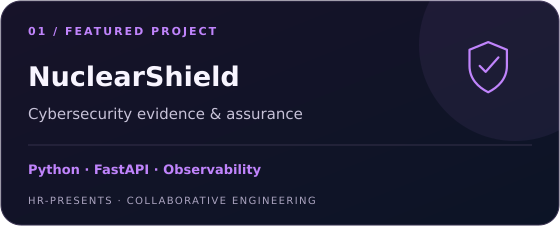</a>

Read-only educational nuclear cybersecurity evidence analysis: provenance, findings, assurance, audit and application observability

<a href="demo-gallery.md#nuclearshield">Case study and demo</a> · <a href="verification.md">Verified source run</a>

</td>
<td width="50%" valign="top">
<a href="demo-gallery.md#sentrix-v1">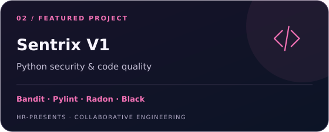</a>

Joint HR-Presents product combining Bandit, Pylint, Radon, Black and syntax checks with structured reporting

<a href="demo-gallery.md#sentrix-v1">Public product overview</a>

</td>
</tr>
<tr>
<td width="50%" valign="top">
<a href="https://github.com/HR-Presents/AegisLog">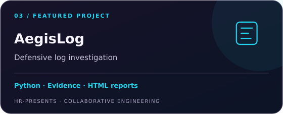</a>

Joint defensive log investigation product with source-preserving analysis, evidence review and local HTML reports

<a href="demo-gallery.md#aegislog">Demonstration and evidence</a>

</td>
<td width="50%" valign="top">
<a href="https://github.com/ruveeha33/AI-Log-Analyzer">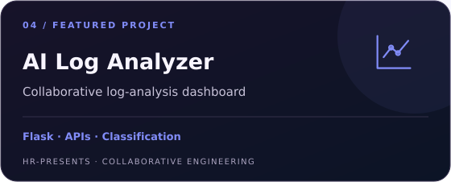</a>

Developed the <strong>Flask backend and API handling</strong>; Haziq contributed frontend/API integration and Ambreen contributed classification logic

<a href="https://github.com/ruveeha33/AI-Log-Analyzer#team-roles">Full team credits</a>

</td>
</tr>
<tr>
<td width="50%" valign="top">
<a href="https://github.com/ruveeha33/linux-backup-recovery-system">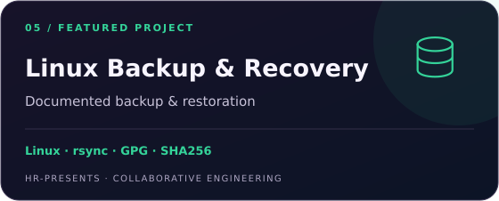</a>

Team workflow using rsync, tar, GPG, SHA256, SSH and cron, documented through restoration evidence

<a href="professional-background.md#project-contributions-and-credits">Workflow and contributors</a>

</td>
<td width="50%" valign="top">
<a href="https://github.com/ruveeha33/jira-python-automation-bot">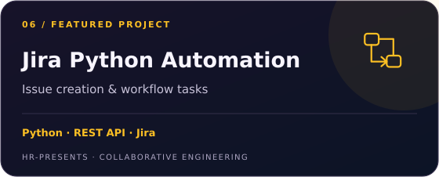</a>

Joint Python REST API project for Jira issue creation and workflow tasks

<a href="https://github.com/ruveeha33/jira-python-automation-bot">Repository</a>

</td>
</tr>
</table>

**[Open the demo gallery →](demo-gallery.md)** Project context, original evidence, contributor roles and operating limits.

**More work:** [SFVDS](https://github.com/ruveeha33/sfvds) · [Smart Mount Manager](https://github.com/ruveeha33/Smart_Mount_Manager) · [LinuxOps Enterprise Lab](https://github.com/HaziqBinAfzal/linuxops-enterprise-lab)  
**Learning evidence:** [AWS Cloud Practitioner](https://github.com/ruveeha33/Trained-AWS-Cloud-Practitioner) · [Generative AI training](https://github.com/ruveeha33/Trained-AWS-Generative-AI-Practitioner) · [ISC2 domain courses](https://github.com/ruveeha33/ISC2-CC-Training-Certs-Repo)

## 💻 Tech Stack

**Programming & automation**

**Linux & cloud**

**DevOps & observability**

**Security & investigation**

**AI & ongoing studies**

Tools used across my projects and labs, alongside topics I’m studying. [Skills and learning context](professional-background.md#skills-and-learning).

## Collaboration & teaching

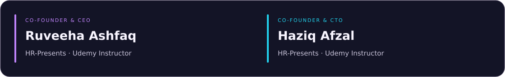

**Haziq Afzal — Co-Founder & CTO, HR-Presents · Udemy Instructor**  
[GitHub](https://github.com/HaziqBinAfzal) · [LinkedIn](https://www.linkedin.com/in/haziq-afzal/)

### Our Udemy courses

Co-created and co-presented by **Ruveeha Ashfaq and Haziq Afzal** under HR-Presents.

<table>
<tr>
<td width="50%" valign="top"><a href="https://www.udemy.com/course/docker-mastery-from-beginner-to-job-ready/">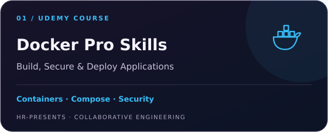</a>
Containers, images, Dockerfiles, Compose, networking, storage, security, troubleshooting and application delivery
</td>
<td width="50%" valign="top">
Scams, phishing, account protection, privacy, AI deepfakes and safer everyday digital decisions
</td>
</tr>
</table>

Our shared work includes lesson preparation, demonstrations, recording, quizzes, presentations and downloadable practice materials.

## GitHub activity & languages

<a href="./assets/dynamic/data.json">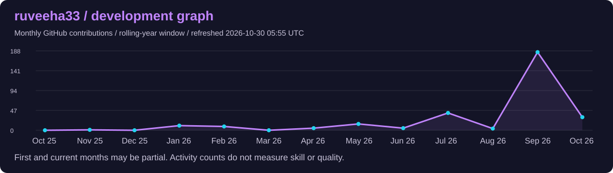</a>

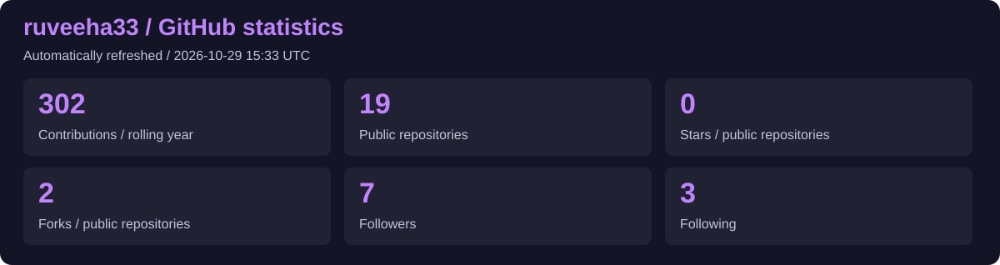
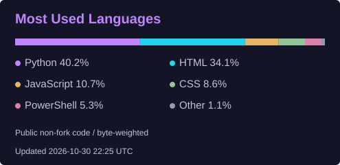

Automatically refreshed every six hours. Cards show the last successful refresh time. Public non-fork language share is not a proficiency score. Historical verification retains its date.

## Background

<strong>Experience, education &amp; professional introduction</strong>

I build practical software and develop my skills through **study, hands-on labs and collaborative projects**. My work connects Python development, Linux administration, defensive security, cloud/DevOps and automation.

At **[HR-Presents](https://github.com/HR-Presents)**, I work alongside **[Haziq Afzal](https://github.com/HaziqBinAfzal), Co-Founder & CTO**. We share ownership and credit across product planning, implementation, testing, troubleshooting, documentation and technical education.

## Experience

| Role | Since | Work |
| :--- | :--- | :--- |
| **Co-Founder & CEO — HR-Presents** | Aug 2026 | Product planning and coordination, hands-on development, testing, troubleshooting and documentation |
| **Udemy Instructor** | Sep 2026 | Two published technology courses co-created and co-presented with Haziq |
| **Student Member — Al Nafi International College** | Aug 2025 | Academic training, controlled labs and collaborative technical projects |

## Education

**AIOPS Level 6 — Artificial Intelligence, Al Nafi International College**  
In progress · Aug 2025–Feb 2027 expected.

[Education, academic activities and earlier schooling](professional-background.md#education)

## Credentials & training

<strong>View credentials, training badges &amp; verification links</strong>

| Learning record | Issuer | Issued | Evidence |
| :--- | :--- | :--- | :--- |
| **AWS Knowledge: Amazon ECS Trained** | AWS | Sep 2026 | [Credly training badge](https://www.credly.com/badges/98503ff9-557c-4649-959d-9dc0086a5173/public_url) |
| **AWS Cloud Quest: Cloud Practitioner** | AWS | Dec 2025 | [Credly training badge](https://www.credly.com/badges/87ff6ebc-a5c2-4770-b61b-e190cf00d218/public_url) |
| **AWS Cloud Quest: Generative AI Practitioner** | AWS | Dec 2025 | [Credly training badge](https://www.credly.com/badges/4fcb5de6-8345-406b-b7b0-87a44c5af982/public_url) |
| **ISC2 CC Domains 1–4** | ISC2 | Nov 2025 | [Individual course completions](professional-background.md#credentials-and-course-completions) |

[Full training record, KodeKloud courses and verification context](professional-background.md#credentials-and-course-completions). Training badges and individual CC domain completions do not establish AWS or ISC2 professional certification.

## Background & contact

I welcome early-career opportunities in Python development, security analysis and infrastructure support, including remote and international roles.

[Full professional background](professional-background.md) · [LinkedIn](https://www.linkedin.com/in/ruveeha-ashfaq/) · [HR-Presents](https://github.com/HR-Presents)

---

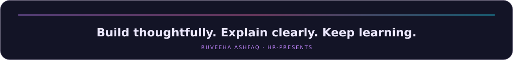

<a href="#featured-engineering-work">Explore projects</a> · <a href="https://www.linkedin.com/in/ruveeha-ashfaq/">Connect on LinkedIn</a> · <a href="#our-udemy-courses">View courses</a>

### Shared products & courses

<!-- SHARED-CONTENT:START -->
**Sentrix V1** — Python security and code-quality review with structured findings and reports.  

**AegisLog** — Local defensive log investigation, retained evidence and HTML reports.  

**Docker Pro Skills** — Build, secure and deploy applications with containers, Compose and practical labs.  

**Think Before You Click** — Online safety through scam recognition, account protection and practical scenarios.  

<!-- SHARED-CONTENT:END -->
