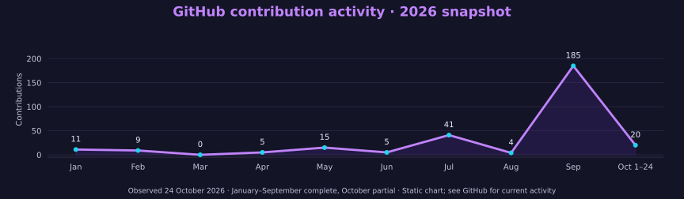

# Ruveeha Ashfaq

Co-Founder & CEO at [HR-Presents](https://github.com/HR-Presents) · Udemy Instructor  
Mandi Bahauddin, Pakistan · AIOPS Level 6 student

[LinkedIn](https://www.linkedin.com/in/ruveeha-ashfaq/) · [GitHub](https://github.com/ruveeha33) · [HR-Presents](https://github.com/HR-Presents)

[Projects](#featured-engineering-work) · [Demo gallery](demo-gallery.md) · [Tech stack](#tech-stack) · [Courses](#our-udemy-courses) · [Credentials](#credentials--training) · [Background](professional-background.md)

---

I work on Python applications, Linux systems and security tools. I’m currently studying AIOPS Level 6 and building projects with Haziq at HR-Presents.

## Featured engineering work

- **[NuclearShield](https://github.com/ruveeha33/NuclearShield)** — An educational, read-only tool for reviewing offline security evidence. It records provenance, flags findings and supports assurance and audit review. [Walkthrough](demo-gallery.md#nuclearshield) · [Verified run](verification.md)

- **[Sentrix V1](demo-gallery.md#sentrix-v1)** — A Python code-analysis application Haziq and I developed at HR-Presents. It brings Bandit, Pylint, Radon, Black and syntax checks into one workflow. [Product overview](demo-gallery.md#sentrix-v1)

- **[AegisLog](https://github.com/HR-Presents/AegisLog)** — Our defensive log-investigation tool. It preserves source logs and produces findings, evidence reviews and local HTML reports. [Demo and evidence](demo-gallery.md#aegislog)

- **[AI Log Analyzer](https://github.com/ruveeha33/AI-Log-Analyzer)** — I developed the Flask backend and API handling. Haziq worked on the frontend and API integration; Ambreen contributed the classification logic. [Team credits](https://github.com/ruveeha33/AI-Log-Analyzer#team-roles)

- **[Linux Backup & Recovery](https://github.com/ruveeha33/linux-backup-recovery-system)** — A team project covering backups and restoration with rsync, tar, GPG, SHA256, SSH and cron. [Workflow and contributors](professional-background.md#project-contributions-and-credits)

- **[Jira Python Automation](https://github.com/ruveeha33/jira-python-automation-bot)** — A joint Python project for creating Jira issues and handling workflow tasks through the REST API.

[Demo gallery](demo-gallery.md) — walkthroughs, evidence, team contributions and project limitations.

NuclearShield verification: **34 tests passed, 1 warning** in the Linux source run on 24 October 2026. [Results and methods](verification.md).

**More work:** [SFVDS](https://github.com/ruveeha33/sfvds) · [Smart Mount Manager](https://github.com/ruveeha33/Smart_Mount_Manager) · [LinuxOps Enterprise Lab](https://github.com/HaziqBinAfzal/linuxops-enterprise-lab)  
**Learning evidence:** [AWS Cloud Practitioner](https://github.com/ruveeha33/Trained-AWS-Cloud-Practitioner) · [Generative AI training](https://github.com/ruveeha33/Trained-AWS-Generative-AI-Practitioner) · [ISC2 domain courses](https://github.com/ruveeha33/ISC2-CC-Training-Certs-Repo)

## Tech stack

| Area | Tools and topics |
| --- | --- |
| Programming & automation | Python, Flask, FastAPI, Bash, Python Automation, REST APIs, Git, Jira |
| Linux & cloud | Linux, Rocky Linux, Red Hat Linux, AWS, Cloud Computing, Linux Administration, SSH |
| DevOps & observability | Docker, Docker Compose, GitHub Actions, CI/CD, DevOps, Prometheus, Grafana |
| Security & investigation | Cybersecurity, Information Security, Network Security, Incident Response, Access Control, Log Analysis, Security Automation, SHA256, Backup & Recovery |
| AI & ongoing studies | Artificial Intelligence, Generative AI, Machine Learning, Anomaly Detection |

Some of these tools appear in my projects; others are part of my ongoing studies. [Skills and learning context](professional-background.md#skills-and-learning).

## Collaboration & teaching

I co-founded HR-Presents with **Haziq Afzal, Co-Founder & CTO**. We also create and teach Udemy courses together.

Haziq: [GitHub](https://github.com/HaziqBinAfzal) · [LinkedIn](https://www.linkedin.com/in/haziq-afzal/)

### Our Udemy courses

Co-created and co-presented by **Ruveeha Ashfaq and Haziq Afzal** under HR-Presents.

- **[Docker Pro Skills: Build, Secure & Deploy Applications](https://www.udemy.com/course/docker-mastery-from-beginner-to-job-ready/)** — Containers, images, Dockerfiles, Compose, networking, storage, security, troubleshooting and application delivery.
- **[Think Before You Click: The Online Safety Course](https://www.udemy.com/course/think-before-you-click-the-online-safety-course/)** — Scams, phishing, account protection, privacy, AI deepfakes and safer everyday digital decisions.

Our shared work includes lesson preparation, demonstrations, recording, quizzes, presentations and downloadable practice materials.

## GitHub activity & languages

Contribution chart: dated snapshot of GitHub’s displayed calendar, with October partial; click for the source counts. Statistics and language cards use external services. Language distribution can include documentation and learning repositories and does not measure proficiency. See GitHub’s contribution calendar below for current activity.

## Background

<strong>Experience, education &amp; professional introduction</strong>

I build practical software and develop my skills through **study, hands-on labs and collaborative projects**. My work connects Python development, Linux administration, defensive security, cloud/DevOps and automation.

At **[HR-Presents](https://github.com/HR-Presents)**, I work alongside **[Haziq Afzal](https://github.com/HaziqBinAfzal), Co-Founder & CTO**. We share ownership and credit across product planning, implementation, testing, troubleshooting, documentation and technical education.

## Experience

| Role | Since | Work |
| :--- | :--- | :--- |
| **Co-Founder & CEO — HR-Presents** | Aug 2026 | Product planning and coordination, hands-on development, testing, troubleshooting and documentation |
| **Udemy Instructor** | Sep 2026 | Two published technology courses co-created and co-presented with Haziq |
| **Student Member — Al Nafi International College** | Aug 2025 | Academic training, controlled labs and collaborative technical projects |

## Education

**AIOPS Level 6 — Artificial Intelligence, Al Nafi International College**  
In progress · Aug 2025–Feb 2027 expected.

[Education, academic activities and earlier schooling](professional-background.md#education)

## Credentials & training

<strong>View credentials, training badges &amp; verification links</strong>

| Learning record | Issuer | Issued | Evidence |
| :--- | :--- | :--- | :--- |
| **AWS Knowledge: Amazon ECS Trained** | AWS | Sep 2026 | [Credly training badge](https://www.credly.com/badges/98503ff9-557c-4649-959d-9dc0086a5173/public_url) |
| **AWS Cloud Quest: Cloud Practitioner** | AWS | Dec 2025 | [Credly training badge](https://www.credly.com/badges/87ff6ebc-a5c2-4770-b61b-e190cf00d218/public_url) |
| **AWS Cloud Quest: Generative AI Practitioner** | AWS | Dec 2025 | [Credly training badge](https://www.credly.com/badges/4fcb5de6-8345-406b-b7b0-87a44c5af982/public_url) |
| **ISC2 CC Domains 1–4** | ISC2 | Nov 2025 | [Individual course completions](professional-background.md#credentials-and-course-completions) |

[Full training record, KodeKloud courses and verification context](professional-background.md#credentials-and-course-completions). Training badges and individual CC domain completions do not establish AWS or ISC2 professional certification.

## Background & contact

I welcome early-career opportunities in Python development, security analysis and infrastructure support, including remote and international roles.

[Full professional background](professional-background.md) · [LinkedIn](https://www.linkedin.com/in/ruveeha-ashfaq/) · [HR-Presents](https://github.com/HR-Presents)

---

<a href="#featured-engineering-work">Explore projects</a> · <a href="https://www.linkedin.com/in/ruveeha-ashfaq/">Connect on LinkedIn</a> · <a href="#our-udemy-courses">View courses</a>

