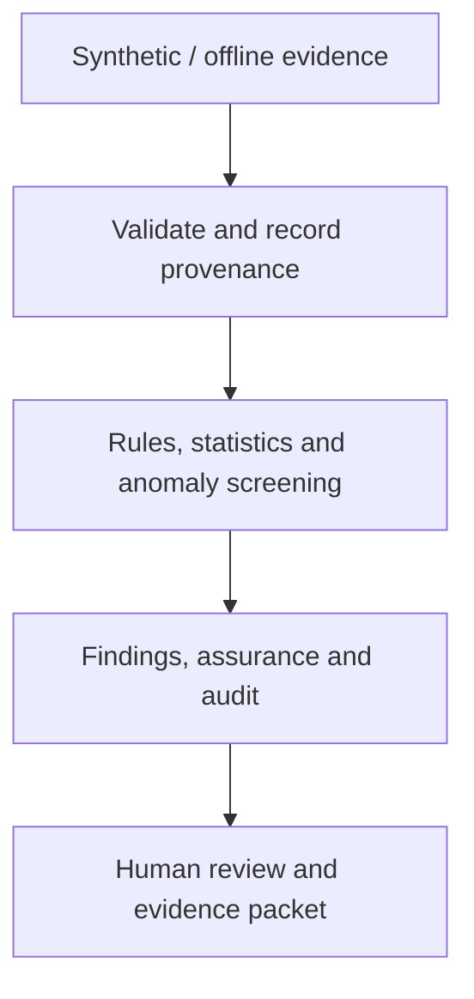

# Engineering demo gallery

[Profile](README.md) · [Background and credits](professional-background.md)

Inspect the problem, implementation and evidence behind each project. Reviewed 24 October 2026.

## NuclearShield

**Problem:** connect offline security evidence to explainable review without giving an analytics application operational control.

NuclearShield is a read-only educational workstation built with Python, FastAPI, scikit-learn, Prometheus and Grafana. It accepts supported CSV, JSON, JSONL and Zeek exports, preserves SHA256 provenance, and combines rules, statistical analysis, exploratory Isolation Forest screening and correlation.

**Walkthrough:** follow the repository's startup instructions, upload the full-platform 100-record JSONL sample, inspect provenance and findings, review assurance and safeguards, export the evidence packet, then inspect application metrics. The 80-record network CSV is a separate focused Isolation Forest demonstration.

[Repository](https://github.com/ruveeha33/NuclearShield) · [Demo guide](https://github.com/ruveeha33/NuclearShield/blob/main/docs/DEMO.md) · [Requirements and limits](https://github.com/ruveeha33/NuclearShield/blob/main/docs/REQUIREMENTS-MAP.md) · [Fresh verification](verification.md)

**Scope:** synthetic/offline decision support. The software policy model is not a physical data diode; mappings do not establish regulatory compliance; observability concerns the application stack. There is no plant-control path or autonomous containment.

## Sentrix V1

**Jointly developed by Ruveeha Ashfaq and Haziq Afzal under HR-Presents.**

Sentrix combines Bandit security checks, Pylint quality analysis, Radon complexity metrics, Black formatting checks and syntax validation. Python-file and ZIP analysis produce findings, source context, guidance, downloadable reports and analysis history.

The source is private. Public visitors can inspect [Ruveeha's product announcement](https://www.linkedin.com/feed/update/urn:li:activity:7518586123997048832/) and [reporting discussion](https://www.linkedin.com/feed/update/urn:li:activity:7497246121958813696/). Shared work spans planning, implementation, testing, troubleshooting, documentation and releases.

Scanner output supports review; it does not prove exploitability or compliance certification. No private source or customer data is republished here.

## AegisLog

**Jointly developed by Ruveeha and Haziq under HR-Presents.**

AegisLog supports defensive log investigation, bounded source coverage, evidence review, incident grouping and local HTML reports while preserving original source logs.

**Walkthrough:** download the synthetic first-investigation demo, analyze its log, review findings and grouped incidents, export reports, then compare the clean baseline.

[Repository](https://github.com/HR-Presents/AegisLog) · [Synthetic demo pack](https://github.com/HR-Presents/AegisLog/tree/main/docs/demo) · [v2.1.17 release](https://github.com/HR-Presents/AegisLog/releases/tag/v2.1.17)

The [shared portfolio verification](https://github.com/HaziqBinAfzal/HaziqBinAfzal/blob/main/docs/verification/2026-10-24/README.md) records an independently executed Linux source run at commit b70abd16e7673b75eabd4cc07fb7ca3a6ccc7a81: 689 tests passed, and the nine-record synthetic investigation produced 2 findings and 1 incident. This is shared product evidence, not a claim that Ruveeha personally performed that verification.

## LinuxOps — Ruveeha's original lab evidence

Ruveeha manages the Rocky Linux environment. The memory incident shows approximately 609 MiB before the configuration change/restart and 3.6 GiB afterward, with zero failed systemd units in the retained capture.

[Incident explanation](https://github.com/HaziqBinAfzal/linuxops-enterprise-lab/blob/main/phases/phase-01/docs/memory-troubleshooting.md) · [All original evidence and credits](https://github.com/HaziqBinAfzal/linuxops-enterprise-lab/blob/main/phases/phase-01/evidence/README.md)

These are historical lab screenshots, not new captures. Haziq's Ubuntu contribution remains separately credited.

## AI Log Analyzer

The team project reviews Linux log events through a Flask application. Ruveeha developed the backend and API handling; Haziq contributed the frontend and integration; Ambreen contributed classification logic.

[Source and original contributor roles](https://github.com/ruveeha33/AI-Log-Analyzer). Descriptions such as AI-style explanations should not be read as proof of a trained model or measured detection accuracy.

## Backup and automation

[Linux Backup & Recovery](https://github.com/ruveeha33/linux-backup-recovery-system) documents rsync, compression, encryption, integrity checking, SSH transfer, cron and restoration. All four group contributors remain credited.

[Jira Python Automation](https://github.com/ruveeha33/jira-python-automation-bot) demonstrates REST API authentication, project retrieval and issue creation. Example success responses in its README are documented expectations rather than new live Jira results.

## Learning and unfinished work

Docker & GitHub Lab and Git Practice were empty at audit time. Python Quality Platform contains a small FastAPI prototype invoking Flake8, Black and autopep8; multiple planned analysis modules are empty. It is distinct from the finished Sentrix product and is not featured as a complete multi-tool platform.

Learning forks retain upstream authorship. [Full background and credits](professional-background.md).

